# Policy-Based Security Verification for Tool-Using AI Agents

[](#implementation-status)
[](pyproject.toml)
[](#project-goal--research-hypothesis)

A research-grade evaluation harness and benchmark environment designed to investigate whether security evaluations of tool-using AI agents can be made more reliable by verifying observed authorization decisions and application state against explicit, formal security policies.

---

## 1. Project Goal & Research Hypothesis

### Goal
The goal of this research project is to design, implement, and evaluate an independent security verification harness for AI agents operating with tool access over multi-tenant application state.

### Research Hypothesis (Provisional)
> **Hypothesis:** Verifying observed execution traces (tool invocations, argument bindings, and authorization contexts) and persistent application state transitions against explicit formal security policies yields higher precision and lower false-negative rates in detecting agent security violations than prompt-level, black-box evaluators (e.g., Promptfoo).

> [!IMPORTANT]
> **Scientific Caveat:** This hypothesis is **provisional and currently unproven**. It represents the guiding research inquiry of this project, not an established scientific conclusion. No claims of novelty, superiority, or breakthrough are asserted prior to empirical validation against baselines.

---

## 2. Provisional Architecture

The system is architected into two strictly separated domains: the **Target Application (`target_app`)** representing the system under evaluation, and the **Security Engine (`security_engine`)** serving as the independent evaluator.

```mermaid
flowchart LR
    subgraph External["External / Attacker Context"]
        User["Adversary / User Session"]
    end

    subgraph TargetApp["Target Application (System Under Test)"]
        direction TB
        API["FastAPI Endpoints"]
        Agent["LangGraph Agent (Ollama / Qwen)"]
        Tools["Tool Handlers"]
        DB[(SQLite Synthetic State)]
        API --> Agent
        Agent --> Tools
        Tools --> DB
    end

    subgraph SecurityEngine["Security Engine (Independent Evaluator)"]
        direction TB
        Capture["Trace & State Interceptor"]
        Policies["Policy Invariant Engine"]
        Verifier["State & Policy Verifier"]
        Reporter["Verdict & Metrics Reporter"]
        Capture --> Verifier
        Policies --> Verifier
        Verifier --> Reporter
    end

    subgraph Baseline["Baseline Evaluation"]
        Promptfoo["Promptfoo Black-box Evaluator"]
    end

    User --> API
    Tools -.->|Passive Trace Observation| Capture
    DB -.->|Pre/Post State Diffs| Capture
    Reporter <-->|Comparative Analysis| Baseline
```



### Trust Boundary Separation
- **Target Application (`target_app`)**: Contains the conversational agent, tool interfaces, and application data. Operates under the assumption that the agent's internal reasoning is untrusted and subject to prompt injection or confused deputy behavior.
- **Security Engine (`security_engine`)**: Operates strictly out-of-band. Observes execution traces and state deltas via passive instrumentation. The target agent has **zero authority** over the verification logic and cannot access evaluation metrics.

---

## 3. Implementation Status

Current Milestone: **Milestone 001 — Foundation Only**

| Component | Category | Current Status | Description |
| :--- | :--- | :--- | :--- |
| **Repository Structure** | Architecture | **Implemented** | Foundational layout, configuration, and documentation templates. |
| **Harness Engineering Rules** | Governance | **Implemented** | Enforceable agent guidelines defined in [`AGENTS.md`](AGENTS.md). |
| **Security Requirements** | Specification | **Implemented** | Formal invariants (SEC-01 multi-tenant isolation) in [`docs/security-requirements.md`](docs/security-requirements.md). |
| **Threat Model** | Specification | **Implemented** | Initial trust boundaries and attack vectors in [`docs/threat-model.md`](docs/threat-model.md). |
| **Target App API** | Runtime | *Planned* | FastAPI service hosting tools and agent workflows. |
| **Target LangGraph Agent** | Runtime | *Planned* | Tool-using agent orchestrated with LangGraph and local Ollama. |
| **Security Verifier** | Runtime | *Planned* | Execution trace and SQLite state diff verification engine. |
| **Promptfoo Baseline** | Evaluation | *Planned* | Comparative black-box evaluation suite. |
| **Empirical Protocol** | Research | *Planned* | Controlled experiment execution and statistical measurement. |
| **Any Security Guarantees** | Assurance | **Unverified** | No security properties are proven or satisfied at this stage. |

---

## 4. Provisional Tech Stack & Justifications

* **Python 3.12+**: Modern type annotations, performance improvements, and stable ecosystem support.
* **Ollama with Qwen (e.g., Qwen 2.5 3B/7B)**: Local, reproducible LLM inference allowing deterministic, offline, and cost-controlled agent testing.
* **LangGraph**: Explicit state-machine-based agent orchestration with inspectable graph states.
* **FastAPI**: Lightweight, asynchronous web framework for hosting the target application.
* **SQLite**: Embedded relational database facilitating fast, deterministic state resetting and atomic state diff comparisons.
* **Pydantic v2**: High-performance data validation and structured schema enforcement.
* **pytest**: Standardized automated test framework for unit, integration, and security invariant tests.
* **Pandas**: Structured tabular analysis of evaluation metrics across experiment runs.
* **Promptfoo**: Industry-standard black-box LLM evaluation framework used as our comparative baseline.

### Deferred Technologies
* **Docker**: Deferred to minimize environment friction during initial architectural bring-up. Local virtual environments are sufficient for Milestone 001. Containerization will be evaluated when multi-platform reproducibility is required.
* **Streamlit**: UI dashboards are deferred. Initial milestones focus exclusively on CLI execution, automated test passes, and JSON/CSV experiment outputs.

---

## 5. Current Limitations

1. **No Executable Runtime**: Milestone 001 establishes the repository architecture, documentation, and harness governance only. Neither the target agent nor the security verifier is implemented yet.
2. **Synthetic Data Assumption**: All test data and user identities are purely synthetic. No production data or external network integrations are modeled.
3. **Local Hardware Dependency**: Agent evaluations require a running local Ollama instance once Milestone 002 is introduced.

---

## 6. Directory Layout

```text
agent-security-research/
├── .env.example                      # Safe environment variable template
├── .gitignore                         # Comprehensive ignore rules
├── AGENTS.md                          # Harness engineering instructions for AI agents
├── pyproject.toml                     # Project metadata and baseline dev dependencies
├── README.md                          # Project overview and status
├── docs/                              # Project documentation
│   ├── architecture.md               # System boundaries and evidence flows
│   ├── security-requirements.md       # Testable security invariants (SEC-01)
│   ├── testing-strategy.md            # Multi-tier testing hierarchy
│   ├── threat-model.md                # Assets, threat vectors, and boundaries
│   ├── decisions/                     # Architecture Decision Records (ADRs)
│   │   └── ADR-001-project-structure.md
│   └── research/                      # Research templates and protocols
│       ├── experiment-protocol.md     # Controlled experiment specification
│       └── literature-review.md       # Literature survey template
├── target_app/                        # Target application source (Planned)
├── security_engine/                   # Policy evaluation engine source (Planned)
├── baselines/                         # External baseline runners (Promptfoo) (Planned)
├── experiments/                       # Experiment scripts and run artifacts (Planned)
└── tests/                             # Automated test suite
    ├── unit/                          # Unit tests (Planned)
    ├── integration/                   # Integration tests (Planned)
    └── security/                      # Invariant property verification tests (Planned)
```

---

## 7. Next Steps (Recommended Milestone 002)

Proceed to **Milestone 002: Synthetic Target Application Foundation**, which will introduce:
1. Synthetic multi-tenant database schema and deterministic SQLite fixture generation.
2. Minimal FastAPI service with authenticated user contexts and CRUD endpoints.
3. Initial unit and integration tests verifying application behavior in isolation before introducing agent orchestration.

