# Policy-Based Security Verification for Tool-Using AI Agents

[](#implementation-status)
[](pyproject.toml)
[](#project-goal--research-hypothesis)

A research-grade evaluation harness and benchmark environment designed to investigate whether security evaluations of tool-using AI agents can be made more reliable by verifying observed authorization decisions and application state against explicit, formal security policies.

**Primary Research Document:** See [`docs/research/research-direction-and-scope.md`](docs/research/research-direction-and-scope.md) for the consolidated research framework, four evaluator conditions, evaluator error taxonomy, and independent ground-truth definitions.

---

## 1. Project Goal & Research Hypothesis

### Goal
The goal of this research project is to design, implement, and evaluate an independent security verification harness for AI agents operating with tool access over multi-tenant application state.

### Refined Research Question (Provisional Gap)
> *"How do progressive levels of evaluator observability—ranging from black-box agent responses to execution traces, backend authorization decisions, and persistent database state diffs—impact the precision, recall, and false-negative rates of security violation detection in tool-using AI agents subjected to unauthorized cross-tenant data access (BOLA/BFLA) attacks?"*

> [!IMPORTANT]
> **Scientific Caveat:** This hypothesis is **provisional and currently unproven**. Within the reviewed literature, no direct evaluation of detector reliability across progressive evidence conditions for multi-tenant authorization violations in tool-using agents was found. No claims of absolute novelty or superiority are asserted prior to empirical testing against baselines.

---

## 2. Provisional Architecture

The system is architected into two strictly separated domains: the **Target Application (`target_app`)** representing the system under evaluation, and the **Security Engine (`security_engine`)** serving as the independent evaluator.

```mermaid
flowchart LR
    subgraph External["External / Attacker Context"]
        User["Adversary / User Session"]
    end

    subgraph TargetApp["Target Application (System Under Test)"]
        direction TB
        API["FastAPI Endpoints"]
        Agent["LangGraph Agent (Ollama / Qwen)"]
        Tools["Tool Handlers"]
        DB[(SQLite Synthetic State)]
        API --> Agent
        Agent --> Tools
        Tools --> DB
    end

    subgraph SecurityEngine["Security Engine (Independent Evaluator)"]
        direction TB
        Capture["Trace & State Interceptor"]
        Policies["Policy Invariant Engine"]
        Verifier["State & Policy Verifier"]
        Reporter["Verdict & Metrics Reporter"]
        Capture --> Verifier
        Policies --> Verifier
        Verifier --> Reporter
    end

    subgraph Baseline["Baseline Evaluation"]
        Promptfoo["Promptfoo Black-box Evaluator"]
    end

    User --> API
    Tools -.->|Passive Trace Observation| Capture
    DB -.->|Pre/Post State Diffs| Capture
    Reporter <-->|Comparative Analysis| Baseline
```



### Trust Boundary Separation
- **Target Application (`target_app`)**: Contains the conversational agent, tool interfaces, and application data. Operates under the assumption that the agent's internal reasoning is untrusted and subject to prompt injection or confused deputy behavior.
- **Security Engine (`security_engine`)**: Operates strictly out-of-band. Observes execution traces and state deltas via passive instrumentation. The target agent has **zero authority** over the verification logic and cannot access evaluation metrics.

---

## 3. Implementation Status

Current Milestone: **Milestone 003 — Part 1.5: Research Consolidation & Methodology Alignment**

| Component | Category | Current Status | Description |
| :--- | :--- | :--- | :--- |
| **Repository Structure** | Architecture | **Implemented** | Foundational layout, configuration, and documentation templates. |
| **Harness Engineering Rules** | Governance | **Implemented** | Enforceable agent guidelines defined in [`AGENTS.md`](AGENTS.md). |
| **Security Requirements** | Specification | **Implemented** | Formal invariants (SEC-01 multi-tenant isolation) in [`docs/security-requirements.md`](docs/security-requirements.md). |
| **Threat Model** | Specification | **Implemented** | Trust boundaries, attacker models, and mitigations in [`docs/threat-model.md`](docs/threat-model.md). |
| **Research Scope & Reference** | Research | **Implemented** | Central reference in [`docs/research/research-direction-and-scope.md`](docs/research/research-direction-and-scope.md) defining conditions A-D and ground truth. |
| **Target App API** | Runtime | **Implemented & Tested** | FastAPI service with SQLite, deterministic seeding, auth, ownership enforcement, and audit events. |
| **Target LangGraph Agent** | Runtime | *Planned* | Tool-using agent orchestrated with LangGraph and local Ollama (Milestone 003 Part 2). |
| **Security Verifier** | Runtime | *Planned* | Execution trace and SQLite state diff verification engine (Milestone 004). |
| **Promptfoo Baseline** | Evaluation | *Planned* | Comparative black-box evaluation suite (Milestone 005). |
| **Empirical Protocol** | Research | *Planned* | Controlled experiment execution and statistical measurement (Milestone 005). |
| **Any Security Guarantees** | Assurance | **Unverified** | Direct backend invariants verified under tested conditions; agent-mediated security remains unverified. |

---

## 4. Provisional Tech Stack & Dependency Management

* **Primary Dependency Specification:** All project dependencies with explicit compatible version constraints are maintained in [`requirements.txt`](requirements.txt).
* **Python 3.12+**: Modern type annotations, performance improvements, and stable ecosystem support.
* **FastAPI & Uvicorn**: Asynchronous web framework hosting the target application API.
* **SQLite**: Embedded relational database facilitating fast, deterministic state resetting, ACID transactions, and atomic state diff comparisons.
* **Pydantic v2 & Pydantic-Settings**: High-performance data validation, structured schema enforcement, and environment configuration.
* **pytest & HTTPX**: Automated test framework with isolated in-memory/temporary file test fixtures and API client testing.
* **Ollama with Qwen** (*Planned M003*): Local, reproducible LLM inference allowing deterministic, offline, and cost-controlled agent testing.
* **LangGraph** (*Planned M003*): Explicit state-machine-based agent orchestration with inspectable graph states.
* **Pandas** (*Planned M005*): Structured tabular analysis of evaluation metrics across experiment runs.
* **Promptfoo** (*Planned M005*): Industry-standard black-box LLM evaluation framework used as our comparative baseline.

### Deferred Technologies
* **Docker**: Deferred to minimize environment friction during initial architectural bring-up. Local virtual environments are sufficient for Milestone 002. Containerization will be evaluated when multi-platform reproducibility is required.
* **Streamlit**: UI dashboards are deferred. Initial milestones focus exclusively on CLI execution, automated test passes, and JSON/CSV experiment outputs.

---

## 5. Local Setup, Execution & Testing Commands

### Installation
Dependencies are tracked in [`requirements.txt`](requirements.txt):
```powershell
python -m pip install -r requirements.txt
```

### Running the Target Application Locally
```powershell
python -m uvicorn target_app.app:app --host 127.0.0.1 --port 8000 --reload
```

### Running Automated Checks & Tests
Execute all tests (unit and integration):
```powershell
python -m pytest -v
```

Execute only security invariant verification tests:
```powershell
python -m pytest -m security -v
```

Execute only fast unit tests:
```powershell
python -m pytest -m unit -v
```

---

## 6. Current Limitations

1. **Synthetic Token Authentication**: The target application uses pre-shared local Bearer tokens (`test-token-user-a`, `test-token-user-b`, `test-token-user-c`) scoped strictly to deterministic offline research evaluation. It does not implement production authentication (no password hashing, JWT signing, or OAuth2 workflows).
2. **SQLite File-Level Audit Integrity**: Audit events are exposed strictly as append-only operations through the application service. However, because SQLite is an embedded file without hardware-enforced write-once storage, direct filesystem access could alter logs out-of-band. External verification is deferred to the planned `security_engine`.
3. **No Agent Orchestration (Milestone 002)**: The AI agent, tool-calling loop, and adversarial prompt evaluation are not yet implemented. The application currently functions as a standalone secure multi-tenant API.

---

## 7. Next Steps (Recommended Milestone 003 — Part 2)

Proceed to **Milestone 003 — Part 2: Agent Tool Integration & Instrumentation Foundation**, which will introduce:
1. Pydantic tool definitions wrapping target application endpoints (`read_record`, `update_record`).
2. Structured execution trace emission hooks for capturing tool invocations, arguments, caller contexts, and return payloads.
3. Minimal LangGraph agent controller wired to local Ollama inference without implementing attack generation or security evaluators yet.

