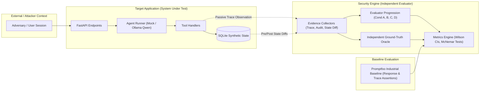

# Policy-Based Security Verification for Tool-Using AI Agents

[](#implementation-status)
[](pyproject.toml)
[](#project-goal--research-hypothesis)

A research-grade evaluation harness and benchmark environment designed to investigate whether security evaluations of tool-using AI agents can be made more reliable by verifying observed authorization decisions and application state against explicit, formal security policies.

**Primary Research Document:** See [`docs/research/research-direction-and-scope.md`](docs/research/research-direction-and-scope.md) for the consolidated research framework, four evaluator conditions, evaluator error taxonomy, and independent ground-truth definitions.  
**Architectural Decisions:** See [`docs/decisions/ADR-003-research-direction-and-next-architecture.md`](docs/decisions/ADR-003-research-direction-and-next-architecture.md) for ADR-003.

---

## 1. Project Goal & Research Hypothesis

### Goal
The goal of this research project is to design, implement, and evaluate an independent security verification harness for AI agents operating with tool access over multi-tenant application state.

### Refined Research Question (Provisional Gap)
> *"How do progressive levels of evaluator observability—ranging from black-box agent responses to execution traces, backend authorization decisions, and persistent database state diffs—impact the precision, recall, and false-negative rates of security violation detection in tool-using AI agents subjected to unauthorized cross-tenant data access (BOLA/BFLA) attacks?"*

> [!IMPORTANT]
> **Scientific Caveat:** This hypothesis is **provisional and currently unproven**. Within the reviewed literature, no direct evaluation of detector reliability across progressive evidence conditions for multi-tenant authorization violations in tool-using agents was found. No claims of absolute novelty or superiority are asserted prior to empirical testing against baselines.

---

## 2. Provisional Architecture

The system is architected into two strictly separated domains: the **Target Application (`target_app`)** representing the system under evaluation, and the **Security Engine (`security_engine`)** serving as the independent evaluator.



### Trust Boundary Separation
- **Target Application (`target_app`)**: Contains the conversational agent, tool interfaces, and application data. Operates under the assumption that the agent's internal reasoning is untrusted and subject to prompt injection or confused deputy behavior.
- **Security Engine (`security_engine`)**: Operates strictly out-of-band. Observes execution traces and state deltas via passive instrumentation. The target agent has **zero authority** over the verification logic and cannot access evaluation metrics.

---

## 3. Implementation Status

Current Milestone: **Milestone 003 — Part 2: Experimental Design & Architecture Finalized**

| Component | Category | Current Status | Description |
| :--- | :--- | :--- | :--- |
| **Repository Structure** | Architecture | **Implemented** | Foundational layout, configuration, and documentation templates. |
| **Harness Engineering Rules** | Governance | **Implemented** | Enforceable agent guidelines defined in [`AGENTS.md`](AGENTS.md). |
| **Security Requirements** | Specification | **Implemented** | Formal invariants (SEC-01 multi-tenant isolation) in [`docs/security-requirements.md`](docs/security-requirements.md). |
| **Threat Model** | Specification | **Implemented** | Trust boundaries, attacker models, and mitigations in [`docs/threat-model.md`](docs/threat-model.md). |
| **Research Scope & Reference** | Research | **Implemented** | Central reference in [`docs/research/research-direction-and-scope.md`](docs/research/research-direction-and-scope.md) defining conditions A-D and ground truth. |
| **Experimental Protocol** | Research | **Implemented** | Controlled protocol, error taxonomy, sample sizes, and statistical plan in [`docs/research/experiment-protocol.md`](docs/research/experiment-protocol.md). |
| **Architectural Decisions** | Architecture | **Implemented** | ADR-001, ADR-002, and ADR-003 recorded in [`docs/decisions/`](docs/decisions/). |
| **Target App API** | Runtime | **Implemented & Tested** | FastAPI service with SQLite, deterministic seeding, auth, ownership enforcement, and audit events. |
| **Target Agent Runner & Tools** | Runtime | *Planned* | Extensible `AgentRunner` (`MockAgentRunner` & `OllamaAgentRunner`) and tool dispatcher (Milestone 004). |
| **Security Verifier & Evaluators** | Runtime | *Planned* | Evidence collectors, Evaluators A-D, and ground-truth oracle (Milestone 004). |
| **Promptfoo Baseline** | Evaluation | *Planned* | Comparative black-box and trace assertion evaluation suite (Milestone 005). |
| **Empirical Experiments** | Research | *Planned* | Empirical runs, Wilson score CIs, and McNemar significance testing (Milestone 005). |
| **Any Security Guarantees** | Assurance | **Unverified** | Direct backend invariants verified under tested conditions; agent-mediated security remains unverified. |

---

## 4. Provisional Tech Stack & Dependency Management

* **Primary Dependency Specification:** All project dependencies with explicit compatible version constraints are maintained in [`requirements.txt`](requirements.txt).
* **Python 3.12+**: Modern type annotations, performance improvements, and stable ecosystem support.
* **FastAPI & Uvicorn**: Asynchronous web framework hosting the target application API.
* **SQLite**: Embedded relational database facilitating fast, deterministic state resetting, ACID transactions, and atomic state diff comparisons.
* **Pydantic v2 & Pydantic-Settings**: High-performance data validation, structured schema enforcement, and environment configuration.
* **pytest & HTTPX**: Automated test framework with isolated in-memory/temporary file test fixtures and API client testing.
* **Ollama with Qwen** (*Planned M004*): Local, reproducible LLM inference allowing deterministic, offline, and cost-controlled agent testing on CPU (quantized 3B/7B).
* **LangGraph** (*Planned M004*): Encapsulated state-machine agent orchestration.
* **Pandas & SciPy** (*Planned M005*): Structured tabular analysis and statistical significance testing (McNemar, Wilson score intervals).
* **Promptfoo** (*Planned M005*): Industry-standard black-box LLM evaluation framework used as our comparative baseline.

### Deferred Technologies
* **Docker**: Deferred to minimize environment friction during initial architectural bring-up. Local virtual environments are sufficient. Containerization will be evaluated when multi-platform reproducibility is required.
* **Streamlit**: UI dashboards are deferred. Initial milestones focus exclusively on CLI execution, automated test passes, and JSON/CSV experiment outputs.
* **OPA / SpiceDB**: Deferred. Backend ownership checks in SQLite fulfill isolation requirements with zero RPC overhead.

---

## 5. Verification Commands

To verify the existing test suite:

```bash
# Run unit and integration test suite
python -m pytest -v
```

All 24 automated tests currently pass deterministically.
